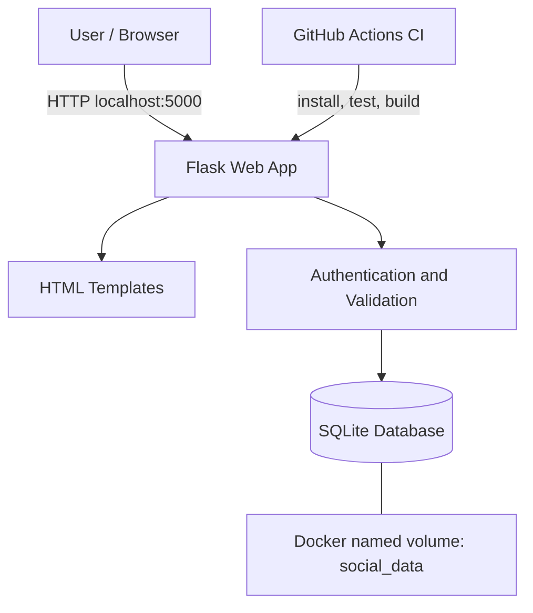

# Architecture and Architecture Decision Record

## Architecture
A monolithic Flask web application serves HTML templates, handles authentication, validates posts and accesses a SQLite database. Docker packages the application; a named volume stores database files.

## Technology choices
- **Frontend:** server-rendered HTML and CSS; minimal dependencies and quick delivery.
- **Backend:** Python Flask; small, readable routing layer.
- **Database:** SQLite; simple local persistence without a separate database server.
- **Authentication:** Flask session plus Werkzeug password hashing.
- **Containerization:** Dockerfile and Docker Compose for repeatable local execution.
- **CI:** GitHub Actions runs pytest and builds the Docker image.

## ADR-001: Choose a Flask monolith with SQLite
**Status:** Accepted

**Context:** The assessment requires a working local MVP in a limited timeframe. Core needs are account management, post creation, a public feed, persistence and Docker-based execution.

**Decision:** Use one Flask application, server-rendered templates and SQLite stored in a Docker named volume.

**Alternatives considered:**
1. Microservices with separate frontend, API and database — rejected because they add deployment and integration overhead.
2. A separate database server — rejected for this small local demonstration because SQLite is easier to run.
3. A JavaScript single-page application — not selected because it would require additional frontend tooling and API integration.

**Consequences and trade-offs:** The monolith is straightforward to understand, test and run. SQLite and server-rendered pages are suitable for a small MVP but are not ideal for high concurrent write traffic or large-scale growth. The architecture can later evolve to a separate API and managed database.

## Known limitations
This is an educational MVP, not production-ready. A production system should add CSRF protection, rate limiting, secure cookie configuration, robust secret management, monitoring and a production-grade database strategy.
